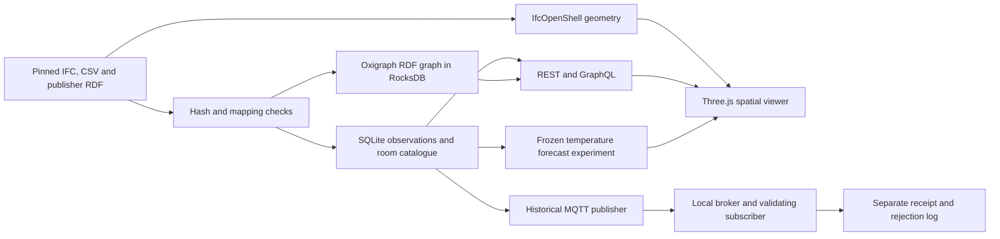

# Connected Building: full local backend

A reproducible demonstrator linking published smart-home measurements to the
actual IFC spaces in the same source dataset. It combines a spatial model,
traceable historical observations, SQL, a persistent RDF graph, REST and GraphQL,
local MQTT transport and a deliberately bounded forecasting experiment.

The public source is [Open Smart Home Data](https://github.com/TechnicalBuildingSystems/OpenSmartHomeData/tree/34acb1fb7a24005ddf29f7f232081713c2f78291),
pinned to commit `34acb1fb7a24005ddf29f7f232081713c2f78291`. Its authors supply
the IFC model, sensor metadata, room alignment and measured CSV files together.
This project preserves the original source notices and CC BY-SA 4.0 licence.

## What is connected

The compact source contains **285,954 original CSV records in 37 channels**,
covering 8 March to 6 June 2017 in UTC. Nine actual IFC spaces are identified;
six have associated monitoring records. Thirty-six channel-to-room associations
are supported by publisher RDF, with one CSV-only candidate kept unverified.
These counts are reproducible from [the source audit](../data/source/20261018_v1_Exact_Mapping_and_Data_Audit.json)
and [the importer](../twin/data.py).

For example, `Room1_Temperature` belongs to the publisher's `Room1-temp-Sensor`.
Its observations identify `Room1`; the publisher's `skos:related` alignment
identifies IFC STEP entity 165; that entity has GlobalId
`05i4VutGDCsQKCrT6CQvhu` in the pinned source IFC. The IFC SHA-256 scopes every
spatial association. The original relationship is retained; it is not silently
changed to `owl:sameAs`. See [the publisher alignment](https://github.com/TechnicalBuildingSystems/OpenSmartHomeData/blob/34acb1fb7a24005ddf29f7f232081713c2f78291/01_LinkOsh.ttl)
and [the stored evidence chains](../twin/semantic.py).



The IFC contains no `IfcSensor` instances. Sensor coordinates, hardware device
GUIDs and calibration results are unavailable. The viewer therefore associates
records with real room geometry and does not invent sensor positions.

## Start the prepared Windows copy

Run `20261018_v1_Start.ps1`. The default address is
[http://127.0.0.1:8765/](http://127.0.0.1:8765/). If another application occupies
that port, choose another port, for example:

```powershell
.\20261018_v1_Start.ps1 -Port 8775
```

The launcher uses the prepared Python environment, keeps mutable SQL, RDF,
MQTT, geometry, forecast artefacts and logs under the local application-data
folder outside OneDrive, and waits for the application health response.
`20261018_v1_Stop.ps1` stops the recorded matching service. Published source files
remain unchanged. The launcher and stop script are inspectable in this directory.

## Reproduce from source

Use Python 3.12. From this project directory, create a short environment outside
OneDrive, install the complete verified dependency lock and select that
environment for the launcher:

```powershell
python -m venv "$env:USERPROFILE\venvs\connected-building"
$py = "$env:USERPROFILE\venvs\connected-building\Scripts\python.exe"
& $py -m pip install -r 20261018_v1_requirements_lock.txt
$env:CONNECTED_BUILDING_PYTHON = $py
.\20261018_v1_Start.ps1 -Port 8775
```

For explicit rebuilding and local verification, stop the service first. The
following commands use project-local derived data by default:

```powershell
.\20261018_v1_Stop.ps1
& $py scripts/build_data.py
& $py scripts/build_geometry.py
& $py scripts/build_analytics.py
& $py -m pytest -q
& $py -m uvicorn twin.main:app --host 127.0.0.1 --port 8775
```

In a new shell, direct build commands and manual `uvicorn` do not automatically
inherit the launcher's state directory. The launcher is the recommended route
for keeping mutable files outside OneDrive. For a custom manual state directory,
set `CONNECTED_BUILDING_DATA_DIR`, `TWIN_RUNTIME_DIR`, `TWIN_GEOMETRY_PATH` and
`TWIN_ANALYTICS_PATH` explicitly before starting Python. Use one service process
per state directory because the RDF store and local broker have a single owner.

After installing dependencies, the compact pinned source is sufficient for the
normal import and analysis. No external account is needed. The optional full
upstream RDF verification downloads a larger source corpus, approximately
116 MB, to a separate cache:

```powershell
& $py scripts/20261018_v1_Verify_Upstream_RDF.py --download
```

The executed [full RDF verification record](../reports/20261018_v1_Upstream_RDF_Verification.json)
compares 277,155 observations and actuations in 36 original RDF files with their
CSV rows, including indices, explicit-offset timestamps, numerical values,
features, devices and units. All checks in that record passed. The compact
package retains hashes, short excerpts and the result; normal startup does not
pretend to repeat this optional download and full comparison.

## Data interpretation

- Air temperature, thermostat temperature, relative humidity and brightness are
  separate measured quantities. Temperature near a radiator is not substituted
  for the room air-temperature target.
- Six outdoor-temperature files are byte-identical copies of one external
  virtual weather feed. They are labelled accordingly and are not counted as
  six independent physical sensors.
- Setpoint histories are recorded controller events. Their sparse timestamps
  are not interpreted as a regular sensor sampling schedule.
- `Toilet_ThermostatTemperature` has no supplied measurement RDF counterpart.
  Its filename-based room suggestion is retained as an unverified candidate and
  excluded from verified room joins by default.
- Six setpoint RDF files use a different namespace. Their raw URIs are retained
  and their room-local-name normalisation is explicitly recorded in the derived
  graph. The source URIs are not asserted to be equal.
- The source README names Room 2 as the room with two thermostats, while the CSV
  filenames and RDF identify Room 3. The application follows the concrete
  CSV/RDF association and exposes the discrepancy.
- No source values are interpolated, filled or averaged at import. Plot sampling
  selects actual rows and states the returned and total counts. Plot gaps use
  original consecutive observation intervals, so downsampling does not create
  false gaps. Complete CSV exports preserve all selected source rows.

These decisions and their source hashes are exposed by `/api/quality` and
`/api/provenance`; see [the quality implementation](../twin/data.py).

## Descriptive heating-command review

`/api/operations` compares measured room air temperature with the last recorded
same-room heating setpoint at or before each observation, with command age
capped at 24 hours. It reports observation coverage, mean and median
differences, mean absolute differences and traceable source-row pairs for the
largest differences. The comparison uses verified IFC room associations and
preserves both source hashes. See [the implementation](../twin/operations.py).

The fractions strictly more than 1 °C above or below the recorded setpoint use
an illustrative application rule. They weight observations, not elapsed time
or occupied hours. A recorded command does not confirm that equipment applied
or maintained it. These comparisons identify records for inspection; they do
not establish occupant comfort, equipment faults, energy savings or causation.

## A real forecasting experiment, including a negative result

The experiment predicts room air temperature approximately one hour ahead,
using actual later measured targets within five minutes of the horizon.
Features use current and past air temperature, last available external weather,
last recorded setpoint and UTC time of day. Missing lag/target coverage is
excluded and reported. Source event time is available; source arrival latency
is unknown, so availability by the recorded timestamp is an experimental
assumption. See [the complete method](../twin/analytics.py).

Each room has chronological 60/20/20 training, validation and test periods.
Training and validation targets crossing the next boundary are purged. Scaling
and Ridge coefficients use training data only. Alpha is selected from five
fixed values using validation MAE. The operational recommendation compares the
candidate with persistence using validation MAE, before consulting test scores.

**All six validation gates select persistence.** The fitted Ridge model is
retained as a rejected experimental candidate. The later test results are
reported as observed; this experiment is not tuned again against those test
periods. The finding is that the proposed extra model complexity has not earned
deployment for this dataset and protocol. The exact results are in
`data/derived/20261018_v1_temperature_forecast.json` and `/api/analytics`.

The displayed error band is the 90th percentile absolute validation error after
model selection on the same validation period. It is descriptive and affected
by selection, not a calibrated prediction interval. Metrics weight eligible
records equally, not elapsed time. Serially dependent records are not
independent experimental trials. There is no energy-use target, ground-truth
occupancy label, energy-saving result or HVAC control claim.

## MQTT and API demonstration

The publisher and subscriber communicate through an actual local MQTT broker
over TCP. The subscriber checks payloads against pinned source rows before
accepting them; duplicate deliveries and rejected payloads are logged.
Original `observed_at` and present-day `received_at` remain separate. This is
**historical measured-data replay**, not current sensor readings or a BMS link.
See [the transport implementation](../twin/transport.py).

Useful interfaces include:

| Interface | Purpose |
|---|---|
| `/api/docs` | Interactive REST schema |
| `/api/summary` | Source identity, counts and component status |
| `/api/rooms` | Actual IFC spaces and verified channel counts |
| `/api/channels?room_guid=...` | Channels belonging to a source-supported room |
| `/api/series/Room1_Temperature` | Bounded original-row time series |
| `/api/series/Room1_Temperature/export.csv` | Complete source-row export |
| `/api/rooms/{guid}/evidence` | SQL and graph alignment evidence |
| `/api/quality` | Gaps, source discrepancies and unverified associations |
| `/api/operations` | Source-linked air-temperature versus heating-command review |
| `/api/graph/query?template=verified_channels` | Executed bounded SPARQL query |
| `/api/analytics` | Frozen forecasting results and limitations |
| `/api/replay/status` and `/api/replay/events` | Broker, subscriber and receipt evidence |
| `POST /api/replay/start`, `/stop`, `/restart-broker` | Local replay and recovery exercise |
| `POST /graphql` | Typed queries over the same room/channel catalogue |

For example, POST this GraphQL query to `/graphql`:

```graphql
{
  room(guid: "05i4VutGDCsQKCrT6CQvhu") {
    roomId
    guid
    channels {
      id
      mappingVerified
      readings(limit: 2) { timestamp value sourceLine }
    }
  }
}
```

The RDF database is an actual persistent [Oxigraph store backed by RocksDB](https://pyoxigraph.readthedocs.io/en/stable/store.html).
It is not a JSON document relabelled as NoSQL. Publisher RDF and application
derivations occupy separate named graphs, and the fixed SPARQL templates are
executed against that stored graph.

## Original local execution and prepared deployment definitions

[The browser verification record](../reports/20261018_v1_Browser_Verification.json)
records an actual `WebGL2RenderingContext`, all nine spaces, source-supported
room/channel selection, unmonitored-room handling, source qualifications and
forecast-gate inspection. Individual checks retain their own outcomes. For
example, an unconfirmed browser download event is separate from API export
integrity checks. [The local test record](../reports/20261018_v1_Test_Results.json)
records its exit code and test outcomes; read the current result before claiming
that a check passed.

`Dockerfile`, `compose.yaml` and `.github/workflows/verify.yml` were prepared
definitions in the original local release. For the current repository, inspect
the latest GitHub Actions run separately from the archived local report. The
original local report does not establish hosted execution. The container configuration separates mutable state, uses one
application worker and exposes HTTP on host loopback in Compose. **Docker
execution and hosted CI execution have not been verified in this environment.**
The original local report supplies no cloud deployment or publication receipt.
The separate GitHub Pages viewer serves static files and does not execute this
backend. See [the GitHub demonstration guide](20261018_v1_GitHub_Demonstration.md).

## Scope and evidence for the role

Read [the demonstration and learning guide](../docs/20261018_v1_Demonstration_and_Learning.md)
and [the criterion-by-criterion evidence matrix](../docs/20261018_v1_Role_Evidence_Matrix.json).
They distinguish working artefact capabilities from the candidate's personal
competence, qualifications and prior experience. The project was assembled with
AI assistance; running code does not establish that its owner can independently
explain or maintain it.

This is a local, historical BIM-linked monitoring and analytics demonstrator.
Hosted execution of the Python backend, a current physical sensor connection, operational BMS
integration, building control, independent sensor calibration, surveyed
as-built verification, energy optimisation and cross-building generalisation
remain outside the demonstrated scope. Revit authoring, BIM-server operations,
Eurocode design checks and professional qualifications are not supplied by this
build. Browser and end-to-end execution evidence must be read from the linked
verification records, not inferred from these instructions or test definitions.

## Licences and attribution

New application code is provided under [MIT](../LICENSE). The public source data,
IFC, RDF, source excerpts and data-derived material retain their CC BY-SA 4.0
attribution and terms. Third-party Three.js files retain their own MIT notice.
See [NOTICE](../NOTICE), [the source licence](../data/source/LICENSE.md) and
[the Three.js notice](../static/vendor/THREE-LICENSE.txt). No institutional endorsement is implied.
